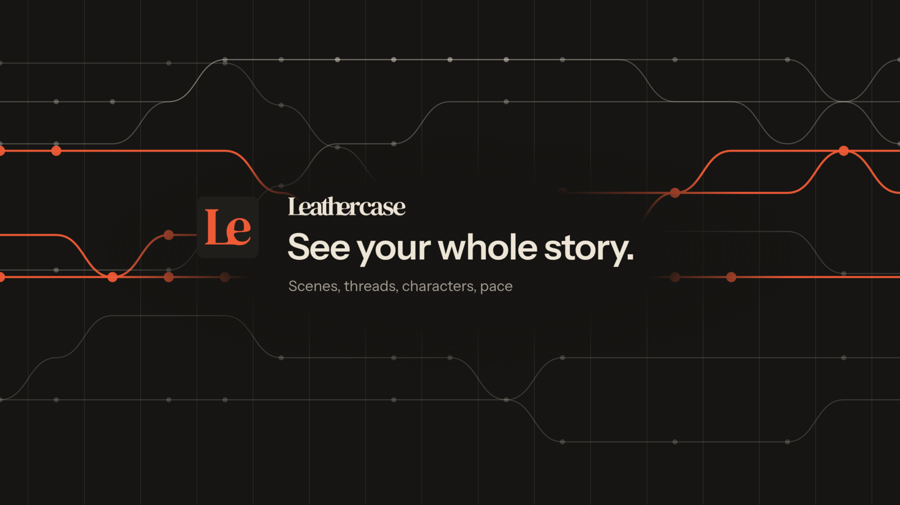

  
  
  
  

  

  A free desktop app that shows you the structure of your book 
  (its <b>scenes</b>, <b>threads</b> and <b>characters</b>) over the files you already write in. 
  Made by a novelist who is also a software engineer.

---

## 📦 Get it

Head to **[leathercase.app](https://leathercase.app)**: it spots your system and hands you the right build. Prefer to pick a file yourself? They're all on the [latest release](https://github.com/Leathercase/leathercase-releases/releases/latest).

| | System | Builds | Status |
|:-:|---|---|---|
|  | **macOS 12+** | Apple silicon · Intel |  |
|  | **Linux** | AppImage · .deb, x86_64 and ARM64 |  |
| 🪟 | **Windows 10+** | Coming to the site when it's ready |  |

🔄 Once it's installed, the app updates itself.

> [!IMPORTANT]
> **On a Mac with a version before 0.30?** The app's identity changed in 0.30, so the updater can't carry it across. Download 0.30 once from [leathercase.app](https://leathercase.app). After that it updates on its own again. Windows and Linux update in place.

## 🤝 Three promises

<table>
  <tr>
    <td width="33%" valign="top">
      <h3>🗂️ Your files, your computer.</h3>
      Leathercase reads the files you write in and never changes them. What it adds is markdown and JSON beside your stories, readable without it, today or in twenty years.
    </td>
    <td width="33%" valign="top">
      <h3>✍️ No AI writing your book.</h3>
      Connect your own assistant if you want one. You see everything it touches, and it never writes prose.
    </td>
    <td width="33%" valign="top">
      <h3>🎁 Free, for good.</h3>
      No trial, no account, no locked features. Patrons fund it, and nothing is held back.
    </td>
  </tr>
</table>

## 📚 Bring your story as it is

Leathercase reads these where they already are, and never changes them:

## 💬 Something off?

- 🐞 [Report a problem with the app](https://github.com/Leathercase/leathercase-releases/issues/new)
- 🌍 [Report a translation mistake on the website](https://github.com/Leathercase/leathercase-releases/issues/new?labels=translation)

Workshops, the questions writers ask, and the legal documents are all on **[leathercase.app](https://leathercase.app)**.

This repository holds the installers and the update feed. The app's source is not here.

---

    
  <a href="https://leathercase.app">
    <picture>
      <source media="(prefers-color-scheme: dark)" srcset=".github/assets/wordmark-paper.png">
      
    </picture>
  </a> 
  Your files stay yours. No AI writes your book. © André Amnc

